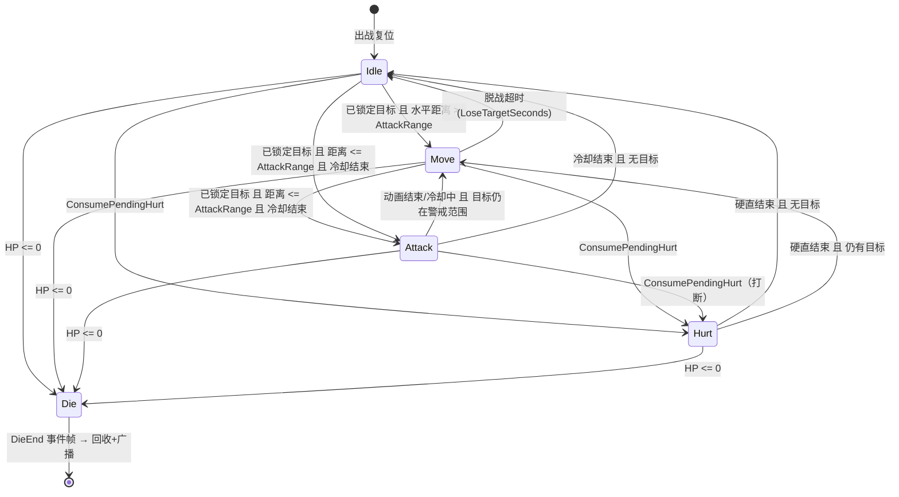
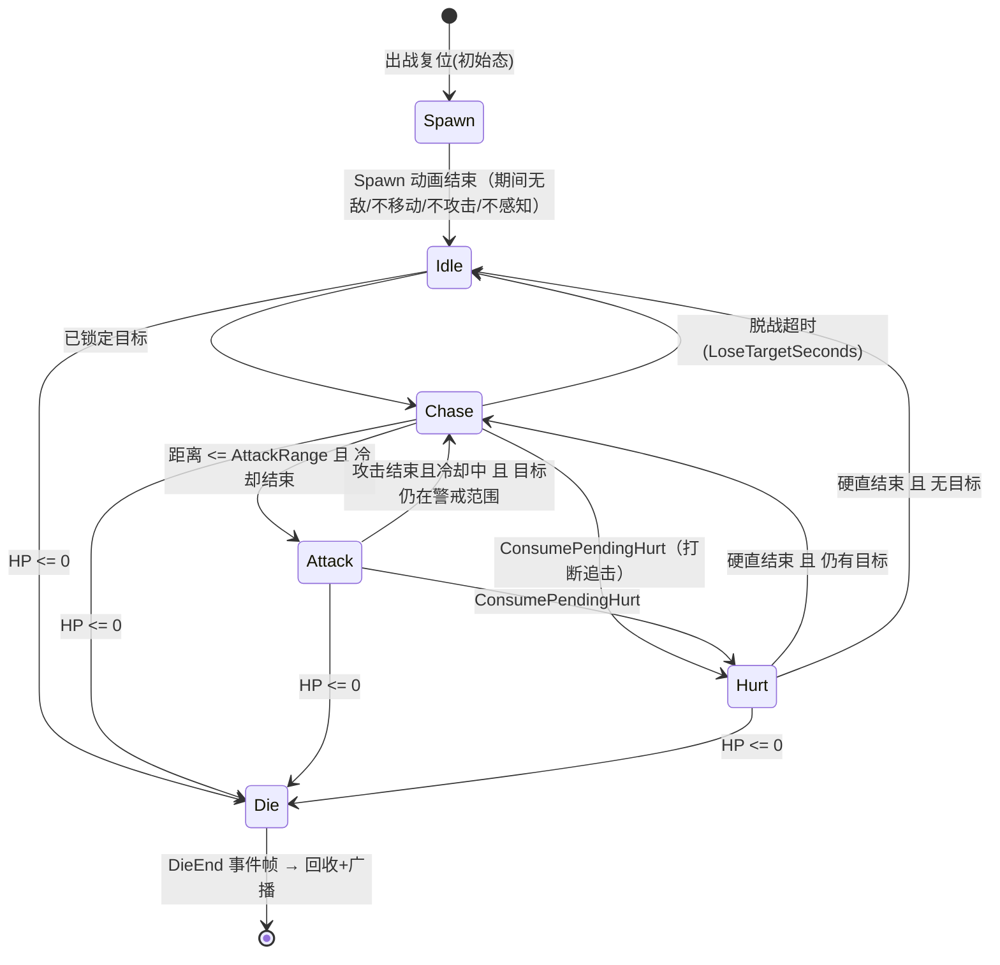
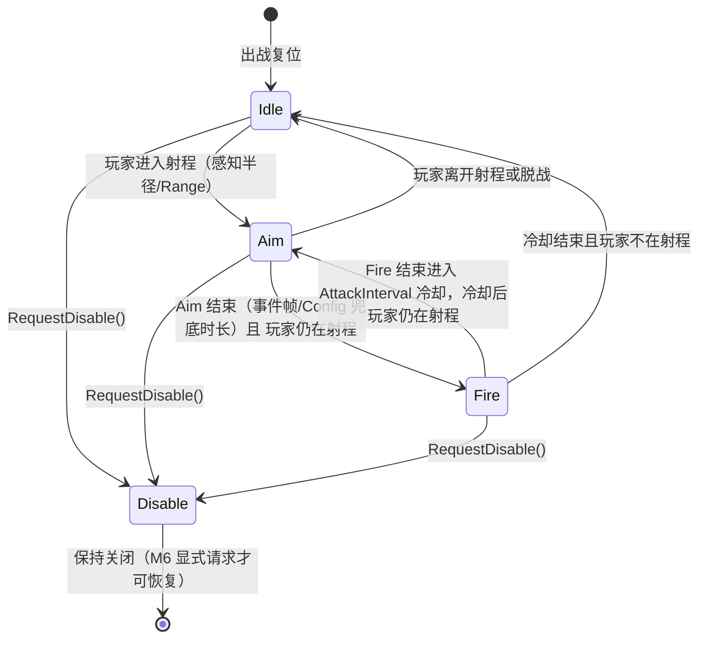
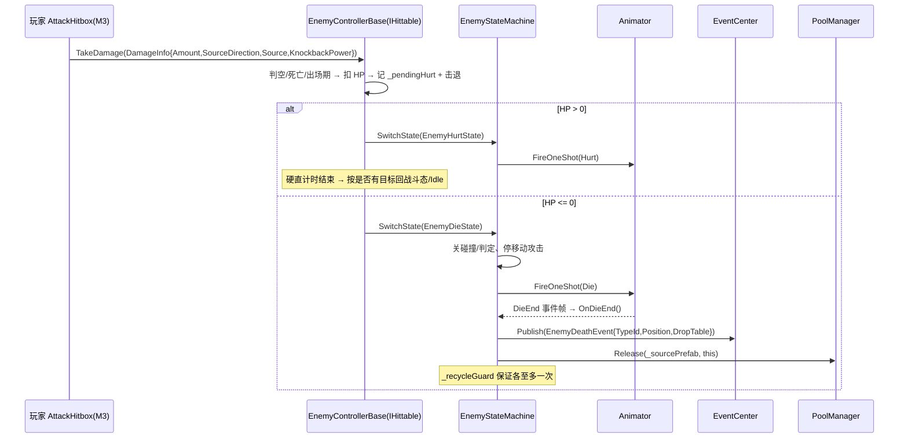
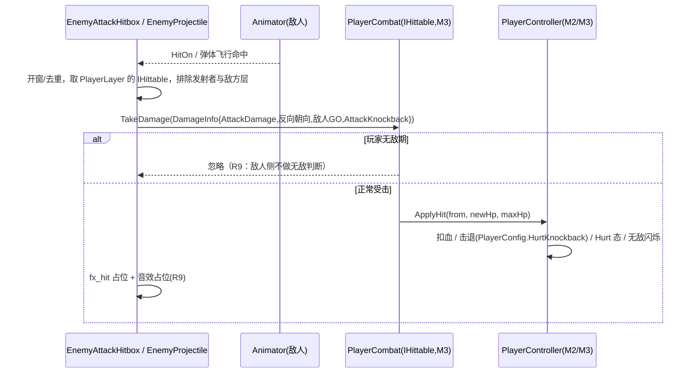
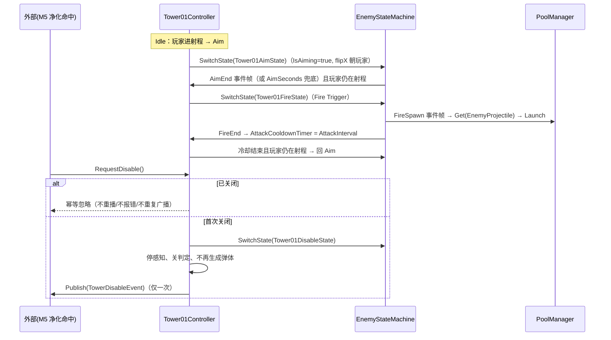

# 技术方案：04-EnemyAI

> 对应 `requirements.md` R1~R11（73 条 EARS） | 命名空间 `StarEco.EnemyAI` | 代码落点 `Assets/Scripts/EnemyAI/`
> 前置已就位：M2 状态机（`StarEco.Player.PlayerStateMachine` 设计模式）、M3 伤害流水线（`StarEco.Combat.IHittable` / `DamageInfo` / 玩家 `AttackHitbox`）、M1 `PoolManager` / `EventCenter` / `AudioManager`
> 立项决策（已定稿，设计不再重议）：Enemy02 弹体命中一次性结算 + `fx_gas`（无持续毒区）；Tower01 单发点射 + `AttackInterval` 冷却（非三连散射）；击退用 `EnemyConfig.KnockbackResponse`（Tower01 固定 0）；每单位一份 `EnemyConfig` 资产（同一字段结构）；Enemy03 `Spawn` 为出场动画（期间无敌 / 不移动 / 不攻击）；敌人攻击判定**新建** `EnemyAttackHitbox`（不改玩家 `AttackHitbox`），两者共享同一 `IHittable` 回调契约；Tower01 关闭后不再开火 / 不再造成伤害

## 1. 结构

### 1.1 与 M3 的边界：复用 / 新建 / 为何不重构（对应 R7、R9）

| 边界项 | 处理 | 依据 |
|---|---|---|
| `StarEco.Combat.IHittable` / `DamageInfo` | **直接复用，零改动** | 敌人实现 `IHittable` 即接入玩家 `AttackHitbox` 的同一条命中流水线（R7：不新增平行伤害通道） |
| 玩家 `AttackHitbox` → 敌人 | **复用，零改动** | `AttackHitbox.OnTriggerEnter2D` 用 `GetComponentInParent<IHittable>()` 取目标，敌人挂 `IHittable` 实现即被命中 |
| 玩家 `PlayerCombat` / `PlayerController.ApplyHit` 处理敌人伤害 | **复用，零改动** | 敌人攻击只需对玩家调 `TakeDamage(DamageInfo)`，扣血 / 硬直 / 无敌 / 击退全部由 M3 侧承担（R9：不由敌人侧判断无敌） |
| 玩家 `PlayerConfig.HurtKnockback` / `HurtInvincibleTime` / `AttackHitbox` | **读写复用，零改动** | 玩家受击手感参数单一事实来源仍在 M2/M3 |
| 玩家 `AttackHitbox` 组件（作为敌人攻击判定） | **不重用，新建 `EnemyAttackHitbox`** | 玩家 `AttackHitbox` 有 `[RequireComponent(typeof(PlayerController))]`，字段读 `_player.Sprite.flipX` 与 `PlayerCombat.Config.AttackDamage`，敌人无 `PlayerController` / `PlayerCombat`，强行复用需为玩家类打洞（改 `RequireComponent` 或加空引用分支），违反"不复用 M3 已验证代码"的约束 |
| 玩家 `PlayerAnimatorDriver` | **不重用，新建 `EnemyAnimatorDriver`** | `[RequireComponent(typeof(Animator))]` 且强引用 `PlayerController`（读 `Body.velocity` / `IsGrounded`），敌人控制器类型不同；两者共享同一"仅通过 Animator 参数通信"的设计模式即可（R11） |
| `StarEco.Player.PlayerStateMachine` / `IPlayerState` / `PlayerStateBase` | **不重用，新建敌人 FSM** | R1 明确要求敌人 FSM 独立，敌人不得反向依赖 `StarEco.Player`（避免 M2/M4 双向耦合）；只对齐"字典注册 + Exit→Enter + Tick/FixedTick 四段式"的设计模式 |
| M3 全部脚本 | **不重构** | M3 已验收（T1~T10 完成），M4 只做增量接线，风险面最小 |

> **一句话边界**：M4 **新增** `StarEco.EnemyAI` 全部文件；对 M3 只**实现**其 `IHittable` 与**调用**其 `TakeDamage`，不改动 M3 任何一行源码。

### 1.2 Prefab 与资产结构（对应 R1、R3~R6、R9、R10、R11）

```text
Assets/Prefabs/Enemies/Enemy01.prefab            Assets/Prefabs/Towers/Tower01.prefab
Assets/Prefabs/Enemies/Enemy02.prefab            Assets/Prefabs/Projectiles/EnemyProjectile.prefab
Assets/Prefabs/Enemies/Enemy03.prefab            Assets/Settings/Enemy01Config.asset ~ Tower01Config.asset
```

```
EnemyXX（Prefab 根，地面直线移动单位 Enemy01/02/03）
 ├─ Rigidbody2D（Dynamic，freezeRotation=true，gravityScale 由 Rigidbody 默认）
 ├─ BoxCollider2D（实体，非 Trigger）
 ├─ SpriteRenderer
 ├─ Animator（EnemyXX 专用 Controller）
 ├─ EnemyXXController        ← 继承 EnemyControllerBase（感知/HP/受击/死亡回收/事件广播）
 ├─ EnemyAnimatorDriver      ← 每帧写 Animator 参数（持 EnemyAnimParams 常量）
 ├─ AttackHitbox（子物体）    ← EnemyAttackHitbox + BoxCollider2D(IsTrigger=true)，按朝向切 localPosition.x 符号
 └─ FirePoint（子物体，仅 Enemy02）← 弹体生成锚点（HitOn 帧取 worldPosition 作发射起点）
```

```
Tower01（Prefab 根，固定单位）
 ├─ BoxCollider2D（实体，非 Trigger）      ← 不挂 Rigidbody2D（无位移、击退系数 0）
 ├─ SpriteRenderer
 ├─ Animator（Tower01_* Controller）
 ├─ Tower01Controller        ← 继承 EnemyControllerBase，重写 IsStatic / KnockbackResponse=0
 ├─ EnemyAnimatorDriver
 └─ FirePoint（子物体）      ← 弹体生成锚点（Fire 事件帧取 worldPosition）
```

```
EnemyProjectile（Prefab 根，毒气弹体，经对象池复用）
 ├─ Rigidbody2D（Kinematic，gravityScale=0）  ← 只在 FixedUpdate 经 MovePosition 位移（性能红线）
 ├─ CircleCollider2D（IsTrigger=true）
 ├─ SpriteRenderer / Animator（可选）
 └─ EnemyProjectile          ← Launch / 命中结算 / 触地 / 超程回收
```

**EnemyConfig 资产（R10）**：`Enemy01Config` / `Enemy02Config` / `Enemy03Config` / `Tower01Config` 各一份，置于 `Assets/Settings/`，共用同一 `EnemyConfig` 字段结构，按单位各填数值（HP 初值 3 / 4 / 5；Tower01 无 HP 亦可配 0 或不可死）。

### 1.3 文件职责表（`Assets/Scripts/EnemyAI/`，每行可直接拆解为一个编码任务）

| 文件 | 职责 | 所属 R |
|---|---|---|
| `EnemyConfig.cs` | ScriptableObject：敌人/炮台全部战斗数值字段 + `CreateDefault()` 兜底与 `CreateAssetMenu` | R10 |
| `EnemyStateMachine.cs` | `IEnemyState` 接口（Enter/Exit/Tick/FixedTick）+ `EnemyStateMachine`（字典注册、重复注册覆盖、`SetInitial(Type)`、`SwitchState<T>` 保证 Exit→Enter） | R1 |
| `EnemyStateBase.cs` | 状态公共基类：持 `EnemyControllerBase` + `EnemyStateMachine`；提供 `TryHandleDieTransition()` / `TryHandleHurtTransition()` / `TryHandleCombatTransitions()` 快捷检查 | R1 |
| `EnemyStates.cs` | 共享状态集：`EnemyIdleState`（待机/感知）`EnemyChaseState`（水平追击）`EnemyMeleeAttackState`（近战开窗+冷却）`EnemyRangedAttackState`（远程生成弹体+冷却）`EnemyHurtState`（硬直+击退）`EnemyDieState`（播放 Die + 等 `DieEnd`） | R1、R3、R4、R5 |
| `EnemyControllerBase.cs` | MonoBehaviour：实现 `IHittable`；持 HP / 目标 / 感知半径与脱战计时 / 硬直与击退 / 攻击冷却 / 死亡 one-shot 守卫；提供 `SenseTarget()`、`DecideCombatState()`、`MoveTowardsTarget()`、`Recycle()`、`BroadcastDeath()`；`ResetForReuse()` 复位 | R2、R7、R8 |
| `EnemyAnimatorDriver.cs` | `EnemyAnimParams` 静态常量类（参数名唯一事实来源）+ 每帧 `SetFloat/SetBool` 与 `FireOneShot(int)` 一次性 Trigger | R11 |
| `EnemyAttackHitbox.cs` | 敌人攻击命中盒：`OnAttackWindowOpen/Close()`（Animation Event）、`OnTriggerEnter2D` 对 `IHittable` 去重结算、对玩家发 `DamageInfo`、命中反馈 `fx_hit` / 音效占位 | R9 |
| `EnemyProjectile.cs` | 毒气弹体：`Launch(ProjectileParams)`、FixedUpdate 位移、命中 / 触地 / 超程回收、不伤发射者与敌方、单目标单次结算、`fx_gas` | R4、R6、R9 |
| `Events/EnemyDeathEvent.cs` | 死亡事件 struct：敌人类型标识 + 死亡位置 + `DropTable` 引用 | R8 |
| `Events/TowerDisableEvent.cs` | 防御塔关闭事件 struct：塔标识 / 位置（供 M5/M6 订阅） | R6 |
| `Enemy01/Enemy01Controller.cs` | Enemy01 慢速近战：注册 Idle/Move/Attack/Hurt/Die（共享状态 + `Enemy01Config`） | R3 |
| `Enemy02/Enemy02Controller.cs` | Enemy02 远程毒气：注册 Idle/Move/Attack(Ranged)/Hurt/Die；`HitOn` 帧取 `FirePoint` 生成毒气弹体 | R4 |
| `Enemy03/Enemy03Controller.cs` | Enemy03 高速追击：注册 Spawn/Idle/Chase/Attack/Hurt/Die；初始态 = Spawn | R5 |
| `Enemy03/Enemy03SpawnState.cs` | 出场状态：播放 `Spawn` Trigger、期间 `IsSpawnImmune=true`、不移动不攻击不感知，动画结束转 Idle | R5、R2 |
| `Tower01/Tower01Controller.cs` | Tower01 固定炮台：注册 Idle/Aim/Fire/Disable；`RequestDisable()` 幂等入口；`IsStatic=true` | R6 |
| `Tower01/Tower01States.cs` | `Tower01IdleState` / `Tower01AimState` / `Tower01FireState` / `Tower01DisableState`（Aim→Fire→冷却→Aim 循环；Disable 终态且幂等） | R6 |

> 说明：`Enemy01` 与其他单位**无专属状态文件**，全部复用 `EnemyStates.cs` 的共享状态（差异由 `Config` 数值 + Animator 参数表达），这是本设计控制文件数与重复代码的核心手段（见 §4 取舍）。

## 2. 关键机制

### 2.1 敌人 FSM（R1）

与 M2 同名同构、命名独立：

| M2（`StarEco.Player`） | M4（`StarEco.EnemyAI`） | 差异 |
|---|---|---|
| `IPlayerState` | `IEnemyState` | 同四段式 `Enter/Exit/Tick/FixedTick` |
| `PlayerStateMachine`（`SetInitial<T>()`） | `EnemyStateMachine`（`SetInitial<T>()` + `SetInitial(Type)`） | 敌人需按单位动态决定初始态（Enemy03 = Spawn），故补一个非泛型重载，避免基类做反射 |
| `PlayerStateBase` | `EnemyStateBase` | 快捷转移方法由"玩家死亡/受击"改为"`IsDead` / `ConsumePendingHurt`"的敌人版本 |
| `Register(state)` 字典键 = `state.GetType()` | 同 | 重复注册后者覆盖（R1） |

- 转移顺序：`SwitchState<T>()` 内 `Current?.Exit()` → 赋值 → `Current.Enter()`（与 M2 一致，R1）。
- 每帧优先级：`EnemyStateBase.TryHandleCombatTransitions()` 在**每个状态 Tick 首行**调用，顺序为 **死亡 > 受击 > 攻击 > 追击/移动 > 待机**（R1 约定）。
- 动画与物理开关**只允许**出现在 `Enter`/`Exit`（R1）：如 `MeleeAttackState.Exit` 关闭 `EnemyAttackHitbox`、`DieState.Enter` 关碰撞与判定。
- 状态内部**不得**直接调用别的状态的方法，一切经 `Machine.SwitchState<T>()`（R1）。
- 出战复位：`EnemyControllerBase.ResetForReuse()` 调 `Machine.SetInitial(InitialStateType)`，`protected virtual Type InitialStateType => typeof(EnemyIdleState)`，`Enemy03Controller` 重写为 `typeof(Enemy03SpawnState)`（R1 最后一条）。

### 2.2 感知与目标锁定（R2）

`EnemyControllerBase.SenseTarget()` 在 **Update** 内、`_machine.Tick()` 之前调用：

```
if (IsDead || IsSpawnImmune) return;                       // R2：出场期/死亡不感知
半径 = HasTarget ? PerceptionRadius + LoseTargetBuffer     // R2：已锁定用扩展半径防抖
                 : PerceptionRadius;
Collider2D hit = Physics2D.OverlapCircle(transform.position, 半径, PlayerLayer);
if (hit != null && |hit.transform.position.y - transform.position.y| <= SameGroundToleranceY)
    → SetTarget(hit.transform); 脱战计时清零（R2：同一地面层）
else
    → 脱战计时 += dt；> LoseTargetSeconds 则 ClearTarget()（R2：超时脱战）
```

- **玩家死亡自动清目标（R2）**：玩家 `PlayerDeathState.Enter` 已 `collider.enabled = false`（M2 既有实现），玩家死亡后不再出现在 `PlayerLayer` 的 OverlapCircle 结果中，敌人自然丢失目标——**无需让 `StarEco.EnemyAI` 反向依赖 `StarEco.Player`**，这是"不引用玩家具体类型"约束下的最优解。
- **朝向（R2）**：统一 `SpriteRenderer.flipX = Target.position.x < transform.position.x`，不缩放 Transform（沿用 M2 约定，避免碰撞体镜像问题）。
- 目标存活期只用于追击/攻击决策，不缓存玩家血量等内部状态（保持零耦合）。

### 2.3 三种敌人行为与状态图（R3、R4、R5）

**状态集合总览**

| 单位 | 状态集合 | 初始态 | 移动动画参数 |
|---|---|---|---|
| Enemy01 污染污泥怪 | Idle / Move / Attack(近战) / Hurt / Die | Idle | `IsMove` |
| Enemy02 变异毒植物 | Idle / Move / Attack(远程) / Hurt / Die | Idle | `IsMove` |
| Enemy03 巡逻机器人 | Spawn / Idle / Chase / Attack(近战) / Hurt / Die | Spawn | `IsMove`（Controller 内映射到 `Enemy03_Chase`） |
| Tower01 毒气防御塔 | Idle / Aim / Fire / Disable | Idle（`IsStatic`） | 无移动 |

**Enemy01 / Enemy02（近战/远程）状态图**



**Enemy03（高速追击，含出场期）状态图**



- **攻击冷却（R3、R4、R5）**：`EnemyControllerBase` 持 `AttackCooldownTimer`。`AttackState.Enter` 置 `= Config.AttackInterval`，各状态 Tick 递减；仅当 `AttackCooldownTimer <= 0` 时才允许 Idle/Move/Chase 转入 Attack。由此保证"动画播完 → 冷却 → 冷却完才可再次攻击"（不连续刷攻）。
- **近战命中窗（R3、R5、R9）**：`EnemyMeleeAttackState` 不自建判定，命中窗由 `EnemyAttackHitbox.OnAttackWindowOpen/Close` 的 Animation Event 控制（帧号对齐动画排期表）。
- **远程弹体生成（R4）**：`EnemyRangedAttackState` 监听 `HitOn` 事件帧调用 `Enemy02Controller.SpawnProjectile()`，取 `FirePoint.position` 与当前朝向，经 `PoolManager.Instance.Get(_projectilePrefab)` 取弹体（不即时实例化）。

### 2.4 Tower01：Aim→Fire→Disable（R6）



- **固定单位（R6）**：`EnemyControllerBase.IsStatic = true` → `FixedTick` 不做任何位移，无 `Rigidbody2D`，`Config.KnockbackResponse = 0`（受击不位移，R7）。
- **瞄准（R6）**：`Tower01AimState.Enter` 写入 `IsAiming=true` Trigger/Bool，`flipX` 朝玩家；不旋转 Transform（沿用 R2 约定）。
- **开火事件帧（R6、R9）**：`Tower01FireState` 的 `OnFireSpawn()` 事件帧 → 取 `FirePoint.position` + 当前瞄准方向 → `PoolManager.Instance.Get(EnemyProjectile)` 发射。
- **Aim→Fire→Aim 循环（R6）**：`Fire` 结束 → `AttackCooldownTimer = AttackInterval` → 冷却后仍锁定则回 `Aim`（不是 Idle），形成 Idle → Aim → Fire → Aim 循环。
- **Disable 幂等（R6）**：外部（M5 净化命中）只调 `Tower01Controller.RequestDisable()`：
  - `if (_isDisabled) return;`（幂等，不重播 Disable、不报错、不重复广播）
  - `_isDisabled = true; _isDisabledOneShot` 守卫世界；切 `Tower01DisableState`
  - Disable 状态：停止感知（`SenseTarget` 短路）→ 不再 Aim/Fire、不再生成弹体、关闭攻击判定（若挂）→ 播放 `Disable` Trigger → 广播 `TowerDisableEvent`（**只在首次关闭广播一次**）
- **不可自恢复（R6）**：M4 不提供"重新激活"的自动逻辑；仅保留 `RequestReactivate()` 空壳（可选，供 M6 检查点流程调用），M4 不自行调用。

### 2.5 受击与 `IHittable` 对接（R7）

`EnemyControllerBase : MonoBehaviour, IHittable`，`TakeDamage(DamageInfo info)` 的业务判定顺序：

| 检查 | 行为 |
|---|---|
| `IsDead == true` | 直接 `return`（R7：死亡后不再受击） |
| `IsSpawnImmune == true`（Enemy03 出场期） | 直接 `return`（R7：出场期免伤） |
| 否则 | `CurrentHP = Mathf.Max(0, CurrentHP - info.Amount)` |
| 受击表现 | 记录 `_lastHitDirection = info.SourceDirection`；`_pendingHurt = true`；`_hurtStunTimer = Config.HurtStunSeconds` |
| 击退（R7） | `KnockbackResponse > 0 && info.KnockbackPower > 0` → 在 `FixedTick` 施加 `-info.SourceDirection.normalized * info.KnockbackPower * Config.KnockbackResponse`；`KnockbackResponse = 0`（Tower01）时不位移 |
| HP 归零（R7） | `_isDead = true` → `TryHandleDieTransition()` 转 `DieState`（**死亡表现由受击流程决定，不由攻击方决定**） |

- **零具体类型引用（R7）**：`TakeDamage` 只读 `DamageInfo` 四个字段，不引用 `PlayerCombat` / `PlayerController` / 任何攻击方类型；命中流水线的开窗与去重在攻击方（玩家 `AttackHitbox` / 敌人 `EnemyAttackHitbox`）。
- 状态由 `EnemyHurtState.Enter` 播放 `Hurt` Trigger 并锁移动，`Tick` 递减硬直后按"是否仍有目标"回战斗态或 Idle（R3/R4/R5 各自的收尾分支由 `EnemyControllerBase.DecidePostHurtState()` 统一给出）。

### 2.6 死亡、事件广播与对象池回收（R8）

死亡是"事件帧驱动的 one-shot 流程"，两道守卫保证"广播一次 + 归还一次"：

```
HP 归零 → _isDead = true → SwitchState(EnemyDieState)
EnemyDieState.Enter:
    Machine 不再受理除 Die 外转移
    关闭实体碰撞体 / EnemyAttackHitbox / 停止移动与攻击（R8）
    Anim.FireOneShot(EnemyAnimParams.Die)                     // 触发 Die 动画
    （回收本状态不做定时器猜测——等事件帧）
Die 动画播到 DieEnd 帧 → Animation Event → EnemyDieState.OnDieEnd()
    if (_recycleGuard) return;   _recycleGuard = true;         // R8 至多一次
    Controller.BroadcastDeath();                               // EventCenter.Publish(EnemyDeathEvent)
    Controller.Recycle();                                      // PoolManager.Release(来源 prefab, this)
```

- **回收（R8）**：`Recycle()` 调 `PoolManager.Instance.Release(_sourcePrefab, this)`，**禁止 `Destroy`**。`_sourcePrefab`（`EnemyControllerBase` 类型自引用）由预制体 Inspector 指定为自身预制体；为空时兜底 `gameObject.SetActive(false)` + `Debug.LogWarning`（与 M3 `PoolManager.Release` 的"无池则销毁"告警呼应，但不走销毁路径）。
- **重复归还安全（R8）**：`ObjectPool<T>.Release` 自带"非本池借出/重复归还 → 警告忽略"防护，`_recycleGuard` 再兜一层，两层都不销毁、不报错。
- **事件（R8）**：`EventCenter.Publish(new EnemyDeathEvent { EnemyTypeId = Config.EnemyTypeId, Position = transform.position, DropTable = Config.DropTable })`，与回收同守卫、同一次调用路径，天然"各自至多一次"。
- **复用复位（R8）**：`OnEnable`（或池取出后显式 `ResetForReuse()`）执行：`CurrentHP = Config.MaxHP`、`_isDead = false`、`_pendingHurt = false`、`AttackCooldownTimer = 0`、速度清零、`Sprite.flipX` 复位、`Anim.ResetParams()`（清 Float/Bool/Trigger）、`Machine.SetInitial(InitialStateType)`——不复用上一生命周期状态。

### 2.7 敌人攻击对玩家的伤害回流（R9）

`EnemyAttackHitbox` 与玩家 `AttackHitbox` 同构、同契约、互不干扰：

| 环节 | 玩家 `AttackHitbox`（M3，不改） | 敌人 `EnemyAttackHitbox`（M4，新建） |
|---|---|---|
| 归属组件 | `[RequireComponent(typeof(PlayerController))]` | `[RequireComponent(typeof(EnemyControllerBase))]` |
| 开窗 | `OnAttackWindowOpen()`（Animation Event：`HitOn`） | 同名方法（Animation Event：`HitOn`） |
| 关窗 | `OnAttackWindowClose()`（`HitOff`） | 同名方法（`HitOff`） |
| 去重 | `HashSet<IHittable>` 单窗一次 | 同 |
| 目标筛选 | 取 `GetComponentInParent<IHittable>()` | 同，且**要求来自 PlayerLayer**（不误伤敌方单位） |
| 伤害来源 | `PlayerCombat.Config.AttackDamage` | `EnemyControllerBase.Config.AttackDamage` |
| 方向 | 面朝反向（受击者→来源） | 敌人朝向的反向 |
| 击退 | 第三段 `ThirdHitKnockback` | `Config.AttackKnockback` |
| 命中反馈 | — | `fx_hit` 占位特效 + `AudioManager.Instance.PlaySfx(clip)` 占位（clip 可空） |

- **开窗期外不命中（R9）**：`OnTriggerEnter2D` 首行 `if (!_windowOpen) return;`。
- **单窗单目标（R9）**：`_hitThisWindow` 集合去重，关窗清空。
- **玩家无敌由玩家侧处理（R9）**：`EnemyAttackHitbox` 不做任何无敌判断，直接 `TakeDamage`；`PlayerCombat.TakeDamage` 内 `InvincibleTimer > 0 → return`（M3 既有）。
- **互不重复结算（R9）**：玩家判定盒挂在玩家身上、敌人判定盒挂在敌人身上，碰撞矩阵（Layer）配置为"玩家攻击盒 ↔ 敌人层"、"敌人攻击盒 ↔ 玩家层"，两组互不可见。
- **朝向翻转时的盒位（R9）**：因约定不缩放 Transform，`EnemyAttackHitbox` 在 `Enter`（或朝向变化时）设 `transform.localPosition = new Vector3(flipX ? -offsetX : offsetX, offsetY, 0)`，保证判定盒始终在面朝侧。

### 2.8 `EnemyProjectile` 生命周期（R4、R6、R9）

```
PoolManager.Get(projectilePrefab)                       // 生成：Enemy02 HitOn / Tower01 Fire 事件帧
   ↓ EnemyProjectile.Launch(ProjectileParams)
     { Direction, Speed(=Config.ProjectileSpeed), MaxRange(=Config.ProjectileMaxRange),
       Damage(=Config.AttackDamage), Knockback(=Config.KnockbackPower 或 Config.AttackKnockback),
       Source(=发射者 GameObject), OwnerLayer(=敌方层) }
   ↓ 每 FixedUpdate：Rigidbody2D.MovePosition(pos + Direction * Speed * fixedDeltaTime)
     累计飞行距离 += Speed * fixedDeltaTime
   ↓ 终止条件（先到先算，全部走同一条"结算+归还"）
     ├─ OnTriggerEnter2D 命中 PlayerLayer 且挂 IHittable → 结算一次伤害 + fx_gas → 归还
     ├─ OnTriggerEnter2D 命中 GroundLayer（触地）→ 不结算，直接归还
     └─ 累计飞行距离 >= MaxRange → 不结算，直接归还
   ↓ PoolManager.Release(projectilePrefab, this)
```

- **不伤发射者 / 不互伤（R4）**：命中时先判 `other.transform.root == Source.transform.root` 或 `other.gameObject.layer == OwnerLayer` → 忽略（毒气弹体对敌方单位与自身均不结算）。
- **单目标单次（R4、R9）**：`_resolved` 标志，首次结算后立即置位并归还，后续 Trigger 不再结算。
- **fx_gas（R4）**：仅在**命中玩家**时生成；触地/超程回收不生成特效。
- **物理红线**：位移只发生在 `FixedUpdate`，弹体入池（`PoolManager`）不即时 `Instantiate`；弹体 `SpriteRenderer` 不参与每帧 `GetComponent`。
- **池化预热**：`Enemy02Config` / `Tower01Config` 可选 `ProjectilePrewarm`，建议首次 `Get` 时带 prewarm，避免战斗首帧分配。

### 2.9 `EnemyConfig` 字段定义（R10）

`[CreateAssetMenu(menuName = "StarEco/Enemy Config")] public class EnemyConfig : ScriptableObject`，字段（全部 `public`，带 `[Header]`/`[Tooltip]`，与 M2 `PlayerConfig` / M3 `CombatConfig` 同风格）：

| 分组 | 字段 | 类型 | 默认 | 说明 |
|---|---|---|---|---|
| 标识 | `EnemyTypeId` | `string` | `"Enemy01"` | 事件携带的单位标识（R8） |
| 标识 | `IsStatic` | `bool` | `false` | Tower01 = true（不位移，R6） |
| 标识 | `AttackKind` | `enum { Melee, Ranged }` | `Melee` | 决定注册近战/远程攻击状态 |
| 生命 | `MaxHP` | `int` | `3` | Enemy01/02/03 = 3/4/5（**R10 GDD §8 初值**） |
| 生命 | `KnockbackResponse` | `float` | `1` | 受击击退系数；Tower01 固定 0（R7） |
| 移动 | `MoveSpeed` | `float` | `1.5` | Enemy03 显著大于 Enemy01（R3/R5） |
| 攻击 | `AttackDamage` | `int` | `1` | 对玩家伤害（R9） |
| 攻击 | `AttackRange` | `float` | `1.0` | Enemy02 远程大于 Enemy01（R4） |
| 攻击 | `AttackInterval` | `float` | `1.2` | 攻击冷却（R3/R4/R5/R6） |
| 攻击 | `AttackKnockback` | `float` | `0` | 命中玩家的击退力（写入 `DamageInfo.KnockbackPower`，R9） |
| 感知 | `PerceptionRadius` | `float` | `6` | 感知半径（R2） |
| 感知 | `LoseTargetSeconds` | `float` | `1.5` | 脱战时长（R2） |
| 感知 | `LoseTargetBuffer` | `float` | `1.0` | **补充**：锁定后的脱战缓冲（防抖，R2） |
| 感知 | `SameGroundToleranceY` | `float` | `1.0` | **补充**：同层判定垂直容差（R2） |
| 受击 | `HurtStunSeconds` | `float` | `0.3` | 受击硬直时长（R7） |
| 弹体 | `ProjectileSpeed` | `float` | `6` | 弹体速度（R4/R10） |
| 弹体 | `ProjectileMaxRange` | `float` | `8` | 弹体最大射程（R4/R10） |
| 弹体 | `ProjectilePrewarm` | `int` | `4` | **补充**：弹体池预热数量 |
| 塔 | `AimSeconds` / `FireSeconds` | `float` | `0.4` / `0.3` | Tower01 Aim/Fire 事件帧兜底时长（R6） |
| 出场 | `SpawnSeconds` | `float` | `0` | **补充**：Enemy03 出场时长兜底（0 = 无出场，R5） |
| 掉落 | `DropTable` | `ScriptableObject` | `null` | 掉落表引用（具体类型由 M5 落地，M4 只透传，R8/R10） |
| 动画 | `AnimFrameRate` | `float` | `12` | 动画帧率（与 M2 手绘 12fps 一致，R10/R11） |
| 兜底 | `CreateDefault()` | `static EnemyConfig` | — | 资产缺失时 `CreateInstance` + `Debug.LogWarning`（**R10 兜底策略**，与 `PlayerConfig` / `CombatConfig` 一致） |

- **单一事实来源（R10）**：敌人数值只读自身 `EnemyConfig`，玩家攻击力仍读 `CombatConfig`，两者解耦；无任何硬编码战斗数值。
- **每单位一份资产（R10）**：`Enemy01Config` / `Enemy02Config` / `Enemy03Config` / `Tower01Config`，同字段结构、各配数值。
- 控制器加载：`Resources.Load<EnemyConfig>("...")` 或 Inspector 指定，为空则 `EnemyConfig.CreateDefault()` + 警告。

### 2.10 动画参数与状态映射（R11）

`EnemyAnimParams` 常量类（`Animator.StringToHash`，与 `PlayerAnimParams` 同策略，代码零裸字符串）：

| 参数名 | 类型 | 语义 | 写入时机 |
|---|---|---|---|
| `Speed` | Float | 水平速度绝对值（可选，表现用） | Driver 每帧 |
| `IsMove` | Bool | 移动/追击中（Enemy01/02 映射 `Move`，Enemy03 映射 `Chase`） | 移动态 Enter/Exit |
| `IsAiming` | Bool | Tower01 瞄准中（false=Idle） | Aim Enter/Exit |
| `Attack` | Trigger | 近战/远程攻击（一次） | 攻击态 Enter |
| `Fire` | Trigger | Tower01 开火（一次） | Fire 态 Enter |
| `Hurt` | Trigger | 受击（一次） | Hurt 态 Enter |
| `Die` | Trigger | 死亡（一次） | Die 态 Enter |
| `Spawn` | Trigger | Enemy03 出场（一次） | Spawn 态 Enter |

**状态 ↔ 参数映射表**

| 单位 | Animator 状态 | 参数表达 | 进入方式 |
|---|---|---|---|
| Enemy01 | `Enemy01_Idle` / `Enemy01_Move` | `IsMove` false/true | Bool |
| Enemy01 | `Enemy01_Attack` / `_Hurt` / `_Die` | `Attack` / `Hurt` / `Die` Trigger | Trigger |
| Enemy02 | `Enemy02_Idle` / `Enemy02_Move` | `IsMove` false/true | Bool |
| Enemy02 | `Enemy02_Attack` / `_Hurt` / `_Die` | `Attack` / `Hurt` / `Die` Trigger | Trigger |
| Enemy03 | `Enemy03_Spawn` | `Spawn` Trigger | Trigger（一次性，初始态） |
| Enemy03 | `Enemy03_Idle` / `Enemy03_Chase` | `IsMove` false/true | Bool |
| Enemy03 | `Enemy03_Attack` / `_Hurt` / `_Die` | `Attack` / `Hurt` / `Die` Trigger | Trigger |
| Tower01 | `Tower01_Idle` / `Tower01_Aim` | `IsAiming` false/true | Bool |
| Tower01 | `Tower01_Fire` | `Fire` Trigger | Trigger |
| Tower01 | `Tower01_Disable` | `Die` Trigger（复用"终态"Trigger）或 `Disable` 专用 Trigger | Trigger（终态，不退出） |

**Animation Event 方法名与调用方（帧号对齐动画排期表「动画事件帧」列，任务中安排一次校验）**

| 事件帧 | 挂载方法 | 目标组件 | 作用 |
|---|---|---|---|
| `HitOn` | `OnAttackWindowOpen()` | `EnemyAttackHitbox` | 开命中窗（R9） |
| `HitOff` | `OnAttackWindowClose()` | `EnemyAttackHitbox` | 关命中窗（R9） |
| `FireSpawn` | `OnFireSpawn()` | `Tower01Controller` | 生成毒气弹体（R6） |
| `ProjectileSpawn` | `OnProjectileSpawn()` | `Enemy02Controller` | 生成毒气弹体（R4） |
| `AimEnd` | `OnAimEnd()` | `Tower01Controller` | Aim → Fire（R6，Config 兜底时长） |
| `FireEnd` | `OnFireEnd()` | `Tower01Controller` | Fire → 冷却（R6，Config 兜底时长） |
| `SpawnEnd` | `OnSpawnEnd()` | `Enemy03Controller` | 出场结束转 Idle（R5，Config 兜底时长） |
| `DieEnd` | `OnDieEnd()` | `EnemyDieState` | 死亡回收 + 事件广播（R8） |

- 逻辑代码**不引用** `AnimationClip` / `Animation` 组件，只经 `Animator` 参数与上述 Animation Event（R11）。
- 若一键搭建工具生成 AnimatorController，参数名以 `EnemyAnimParams` 为准修正（R11 最后一条）。

## 3. 数据流

### 3.1 一次敌人受击 → 死亡 → 回收（R7、R8）



### 3.2 一次敌人攻击命中玩家 → 伤害回流（R9）



### 3.3 Tower01 Aim → Fire → 冷却循环与关闭（R6）



## 4. 设计取舍

- **敌人 FSM 组织方式：一套共享状态 + 各敌种注册子集**（而非"每敌种一套状态类"或"一个大状态机 + N 个 if"）。三种敌人的行为差异几乎只体现在"数值 + 动画参数 + 攻击形态"三处：Idle/Hurt/Die 语义完全一致，Move 与 Chase 只是动画名不同，攻击只有近战/远程两类。因此把 6 个共享状态（`EnemyStates.cs`）作为唯一实现，各 `EnemyXXController` 只负责 `Register` 自己需要的状态子集与差异化字段，实现零逻辑膨胀；差异全部收敛到 `EnemyConfig` + AnimatorController，新增第四种敌人时只加一个 Controller + 一份 Config。代价：共享状态必须通过 `EnemyControllerBase` 的公开能力（`Config` / `HasTarget` / `DecideCombatState()`）而非直接访问子类字段，状态类不能引用 `Enemy01Controller` 具体类型——这是有意为之的解耦。
- **敌人 FSM 不复用 `PlayerStateMachine`**：M2 的状态机类与 `IPlayerState` 在 `StarEco.Player` 命名空间下，直接复用会让敌人依赖玩家命名空间（R1 明令禁止）；同时 M2 的 `SetInitial<T>()` 只有泛型版本，无法在基类按运行时类型选初始态。敌人侧独立实现约 70 行，换来命名空间零耦合与 `SetInitial(Type)` 重载。
- **新建 `EnemyAttackHitbox` 而非参数化玩家 `AttackHitbox`**：玩家盒子的 `[RequireComponent(typeof(PlayerController))]` 与 `_player.Sprite.flipX` / `PlayerCombat.Config` 依赖是 M3 已验证契约；要复用必须给 M3 打洞（去 RequireComponent、加空引用分支），风险大于 60 行新代码。两者以"同一 `IHittable` 契约 + 同名 `OnAttackWindowOpen/Close` 事件方法"保持概念一致，M5 净化攻击仍可复用同一接口。
- **弹体用独立 `EnemyProjectile` + `PoolManager`，而不是"敌人内部计时器模拟弹道"**：Enemy02 与 Tower01 共用同一弹体组件，`Launch(ProjectileParams)` 一个参数结构覆盖两者差异；对象池满足 TDD §2.2 频繁生成物红线；Kinematic Rigidbody2D + `MovePosition` 把位移限制在 FixedUpdate，避免每帧改 transform 造成的物理穿透与 GC。
- **死亡回收用 `DieEnd` 事件帧而非定时器**（与 M3 攻击开窗同哲学）：动画帧率是表现节奏的权威，改帧只改 clip 不碰代码；`_recycleGuard` 保证"广播一次 + 归还一次"。
- **击退走 `Config.KnockbackResponse` 系数而非按单位写 if**：Tower01 设 0 即天然"重甲不动"，Enemy01 后续若需"抗击退"也只改数值不碰代码。
- **Tower01 的 Disable 做成幂等入口 + 终态**：M4 明确不拥有"净化"语义（M5 才定义），只对外暴露 `RequestDisable()` 并广播事件；把"是否已关闭"的判断收在控制器一处，避免 M5 二次命中重播动画。
- **感知复用"玩家死亡态关闭 Collider"的既有事实**：R2 要求"玩家死亡清目标"，若在敌人侧读玩家状态会引入 `StarEco.EnemyAI → StarEco.Player` 反向依赖；改用 Layer 探测后，玩家死亡自然消失于探测结果，零耦合地满足需求。
- **EnemyConfig 每单位一份资产**：字段结构复用、数值各自编辑；答辩时"数值与代码分离"可解释性强，且切换资产即可复现三种敌人手感差异（验收方式要求）。
- **`DropTable` 用 `ScriptableObject` 宽类型占位**：M4 不含掉落实现（M5 范围），事件与 Config 只透传引用，避免 M4 提前引入 M5 的类型。

## 5. 风险

- **感知的"同一地面层"判定过简**：当前用 `SameGroundToleranceY` 垂直容差 + `PlayerLayer` OverlapCircle，若关卡存在"上下两层平台且垂直距离小于容差、中间无墙"的地形，敌人可能隔层锁定玩家。缓解：容差参数化 + 必要时改为 `Physics2D.Linecast` 校验其间无 Ground 层遮挡（属可调项，不阻塞 M4）。
- **玩家死亡只关了一个 Collider2D**：M2 `PlayerDeathState.Enter` 用 `GetComponent<Collider2D>()` 只禁用**第一个**碰撞体；若 M2 玩家预制体挂了多个 Collider2D（脚部 + 主体），玩家死后仍可能被感知到，R2"死亡清目标"退化为"脱战超时后清目标"。缓解：M4 侧不依赖单点，`SenseTarget` 同时做"命中对象是否 enabled"与脱战计时双保险；如需彻底修复需回 M2 预制体结构，属跨里程碑改动，**建议在 tasks 中列为一次校验项而非 M4 内改造**。
- **Animation Event 帧号与排期表未对齐**：`HitOn`/`HitOff`/`DieEnd`/`FireSpawn`/`ProjectileSpawn`/`AimEnd`/`FireEnd`/`SpawnEnd` 的帧号必须与动画排期表「动画事件帧」列严格一致（R11）。若帧号与 clip 长度不匹配（如 `HitOn` 落在攻击前摇之外），会出现"判定早于表现"或"永不命中"。缓解：每个 clip 补事件后逐条 Play 目检，tasks 中安排一次统一校验（与 M3 的 T7/T11 同策略）。
- **物理层与碰撞矩阵是隐性依赖**：玩家攻击盒只应命中敌人层、敌人攻击盒只应命中玩家层、弹体只应命中玩家层与地面层。若 Layer 未配置，会出现"敌人互殴"或"弹体打中敌人自身"（R4 明确禁止）。缓解：在结构章节给出碰撞矩阵，tasks 中安排一次 Layer/Collision Matrix 配置与 Play 验证。
- **Aim/Fire/Spawn 的"结束"用 Config 时长兜底**：在事件帧接入前，Aim→Fire 等转移依赖 `AimSeconds`/`FireSeconds`/`SpawnSeconds`，改动画长度会与兜底时长脱节（表现与逻辑错拍）。缓解：与 M3 `SegmentEndTimes` 同策略——事件帧为权威、Config 仅兜底，并在 design/tasks 中标注"接入事件后以事件为准"。
- **敌人冷却与"动画未播完"的竞争**：若 `AttackInterval` 短于攻击动画时长，可能出现"动画还在播但冷却已结束"。缓解：`AttackState` 期间不接受再次转入，冷却计时从 `Attack.Exit` 起算并在 Tick 递减；数值上线前用 `AttackInterval >= 动画时长` 做一次目检。
- **Enemy03 出场期的边界**：Spawn 期间"不感知 + 免伤 + 不移动"三态同时成立，若 `SpawnEnd` 事件缺失且 `SpawnSeconds = 0`，会卡在无敌出场态。缓解：`SpawnSeconds > 0` 时以配置兜底强制退出 Spawn；tasks 中验证"缺事件也能出场"。
- **死亡事件的 `DropTable` 为空**：M5 未落地前 `Config.DropTable == null`，订阅方需判空。缓解：事件契约允许 null，M5 接入时再绑定资产（不阻塞 M4）。
- **每帧 GC 与 Find/GetComponent 红线**：所有 `GetComponent` 必须在 `Awake` 完成并缓存（含 `EnemyAttackHitbox` 的 `_owner`、`EnemyProjectile` 的 `Rigidbody2D`），Update 内禁止 `Find*`；`SenseTarget` 的 `OverlapCircle` 建议用 `Physics2D.OverlapCircleNonAlloc` + 复用数组以达"每帧零 GC"。

## 6. 待澄清 / 与 requirements 的偏差说明

| 编号 | 事项 | 现状与建议 |
|---|---|---|
| C1 | `PlayerDeathState` 只禁用单个 Collider2D（见 §5 风险 2） | 建议 M4 以"双保险"实现不改造 M2；若验收要求"玩家死亡立即可靠清目标"，需回 M2 改为禁用全部 Collider2D，请确认是否在 M4 范围内 |
| C2 | Tower01 的 `Disable` 动画参数名 | 需求 R11 未为 Tower01 定义 `Disable` 触发参数名。设计复用 `Die` Trigger 以保持"终态 Trigger"语义统一，或另立 `Disable` Trigger；以 `EnemyAnimParams` 常量为准，需与美术 AnimatorController 对齐后定稿 |
| C3 | `EnemyConfig` 的补充字段（`LoseTargetBuffer` / `SameGroundToleranceY` / `AttackKnockback` / `Prewarm` / `SpawnSeconds` / `AimSeconds` / `FireSeconds`） | R10 用"至少包含"表述，未禁止扩展；以上为实现 R2/R3/R5/R6/R9 所必需，属设计补充，请确认是否允许写入 Config |
| C4 | Animation Event 帧号 | 排期表「动画事件帧」列未在本次输入中提供，设计仅给出方法名与挂载组件；帧号需在 tasks 阶段按排期表逐条补齐并校验 |
| C5 | `EnemyDeathEvent.DropTable` 的具体类型 | M4 用 `ScriptableObject` 占位透传，M5 落地掉落表具体类型后可能需要一次类型收窄（属 M5 范围） |
| C6 | Tower01 是否可被玩家打死 | R6 只描述"被净化关闭"，未给 Tower01 的 HP 语义；设计按 `MaxHP > 0 时可死 / = 0 时不可死` 由 Config 决定，默认 Tower01 走 Disable 而非 Die，请确认 |