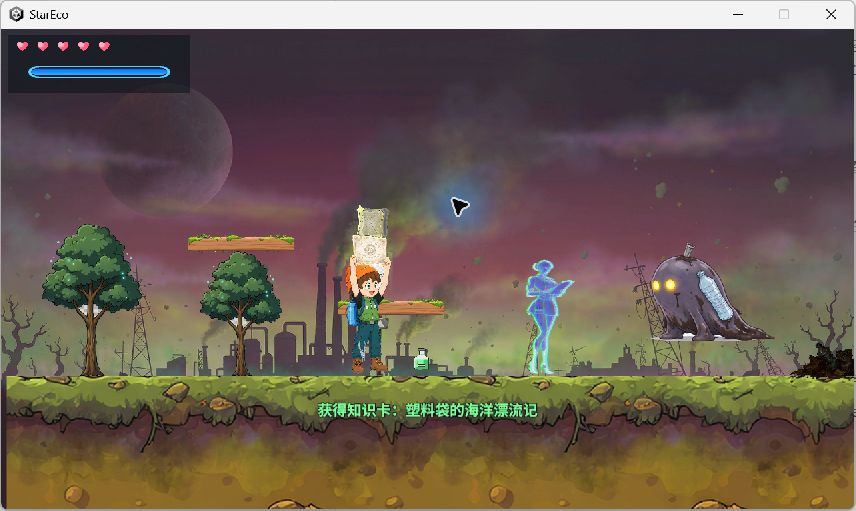

# StarEco · 星际环保

基于 Unity 2D 的横版动作冒险项目：在三个关卡中移动、战斗、净化污染、解救目标，并挑战多阶段 Boss。此仓库用于源码学习与求职展示。

**[下载 Windows 试玩包](https://github.com/wxs-games/star-eco-adventure-unity2d/releases/tag/build-2026-11-03)** · [技术总览](Docs/开发文档/docs/SystemOverview.md) · [AI 协作说明](Docs/AI-工作流.md) · [本次构建验证](Docs/Release-2026-11-03.md)

## 快速试玩

1. 在 Releases 下载 `StarEco-Windows-x64-2026-11-03.zip`。
2. 完整解压到一个可写目录，运行 `StarEco/StarEco.exe`；保留同目录的 `StarEco_Data/`、`UnityPlayer.dll` 和 `MonoBleedingEdge/`。
3. 从标题界面开始游戏，或使用关卡选择查看已解锁关卡。

| 操作 | 按键 |
|---|---|
| 移动 | A / D 或 ← / → |
| 跳跃 | Space；松开可控制跳跃高度 |
| 攻击 | J 或鼠标左键 |
| 净化喷洒 / 蓄力喷洒 | K / L |
| 交互 | E |
| 翻滚 / 冲刺 | 左 Shift / 左 Ctrl |
| 暂停 | Esc |

Windows x64；源码和游戏包均采用 Unity 2022.3.62f3c1。Release 内附操作说明、版本信息、校验值及验证记录。

## 实机画面



2026-11-03 成品包运行截图。完整三关流程的本次复测范围见验证记录。

## 值得查看的实现

| 模块 | 实现与阅读入口 |
|---|---|
| 玩家移动与状态切换 | [PlayerController](Assets/Scripts/Player/PlayerController.cs) 与 [PlayerStates](Assets/Scripts/Player/PlayerStates.cs)：跳跃缓冲、郊狼时间、可变跳高、翻滚与冲刺 |
| 战斗与 Boss | [Combat](Assets/Scripts/Combat)、[Boss](Assets/Scripts/Boss)：攻击判定、受击反馈、连段与阶段状态切换 |
| 环保玩法与目标链 | [Eco](Assets/Scripts/Eco)、[LevelObjectiveTracker](Assets/Scripts/Level/LevelObjectiveTracker.cs)：净化行为、目标推进和关卡结算 |
| 基础框架 | [Framework](Assets/Scripts/Framework)：泛型事件中心、对象池、音频与 JSON 存档 |
| 数据与表现分离 | [Settings](Assets/Settings) 中的 ScriptableObject 配置、[UI](Assets/Scripts/UI) 中的界面与反馈 |
| 开发工具 | [Editor](Assets/Scripts/Editor) 与 [美术管线](Tools/art-pipeline)：装配菜单、资源处理与逐帧动画处理 |
| 自动化验证 | [EditMode 测试](Assets/Tests/EditMode)：核心计算与存档等逻辑测试 |

这些入口用于展示实际实现；未实测的性能、未启用的脚本功能不作为本次发布承诺。历史设计文档包含规划、已知问题和早期数据，阅读时以当前代码及本次验证记录为准。

## 从源码运行

```bash
git clone https://github.com/wxs-games/star-eco-adventure-unity2d.git
```

1. 使用 Unity Hub，以 **Unity 2022.3.62f3c1** 打开仓库根目录。
2. 等待 `Packages/manifest.json` 中依赖解析完成；首次打开需要网络。Unity MCP 为开发工具，运行游戏不需要配置 AI 服务密钥。
3. 打开 `Assets/Scenes/Title.unity` 并进入 Play。
4. 执行 `Window → General → Test Runner → EditMode → Run All` 可运行现有测试。

构建使用 Windows x86_64 / Mono；场景顺序固定为 `Title → Level01 → Level02 → Level03`。在 Build Settings 中构建到一个新目录；完整流程见 [BuildAndRelease](Docs/开发文档/docs/BuildAndRelease.md)。

## 项目结构

```text
Assets/            脚本、场景、预制体、配置、动画、图像、音频及测试
Packages/          Unity 包清单和已嵌入的开发依赖
ProjectSettings/   可复现工程设置
Docs/              展示说明、构建验证、开发文档与规格
Tools/             美术处理和数值辅助工具
```

`Library/`、`Temp/`、`Builds/`、Python 缓存和临时截图不作为源码交付。可玩包通过 GitHub Release 分发。

## AI 协作与许可

开发过程中使用 AI 辅助代码、问题定位、文档和美术处理；求职展示中应结合具体提交解释设计取舍与验证过程，详见 [AI 协作说明](Docs/AI-工作流.md)。

项目自有代码按 [MIT](LICENSE) 提供；字体及第三方组件保留各自许可，详见 [素材与第三方说明](Docs/THIRD_PARTY.md)。不要将仓库的 MIT 标记理解为对第三方素材许可的替代。
